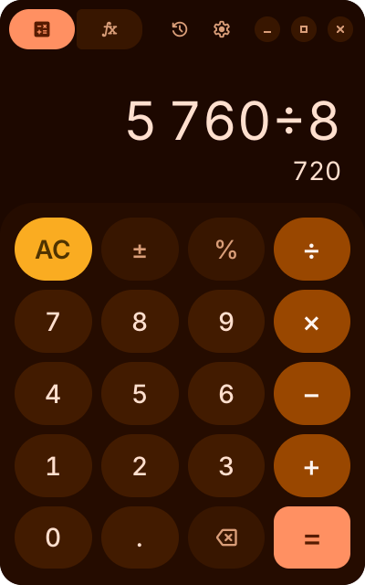
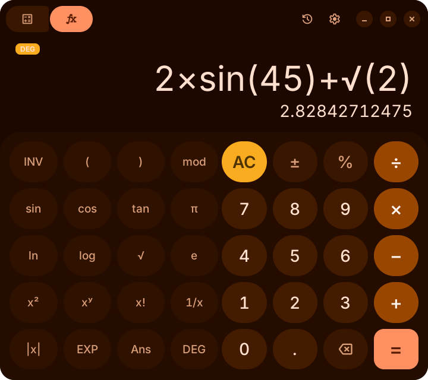

<p align="center">
  
</p>

<h1 align="center">Calculator</h1>

<p align="center">
  A GTK 4 calculator for Linux with a Material 3 Expressive style. It takes its colours from the desktop (dark mode and accent colour) or from a palette you choose.
</p>

<p align="center">
  
  
  
  
  
  
</p>

<p align="center">
  <a href="#installation">Install</a> ·
  <a href="#features">Features</a> ·
  <a href="#keyboard-shortcuts">Shortcuts</a> ·
  <a href="#colours">Colours</a> ·
  <a href="CHANGELOG.md">Changelog</a>
</p>

---

> **AI disclosure:** This project was written almost entirely by an AI assistant, with direction and testing by the author. It works on the setups it was tested on (Hyprland), but review the code before relying on it.

<p>
   
</p>

## Features

- Standard and scientific modes. Scientific adds trigonometric functions (degrees or radians), logarithms, powers, roots, factorial, absolute value, modulo, π, e, `Ans` and E notation.
- Live result preview while typing; pressing `=` again repeats the last operation.
- History of past results, saved between sessions (can be turned off).
- Colours from the desktop through the XDG Desktop Portal, GSettings or the GTK theme, so it works on GNOME, KDE, Hyprland, niri, Sway and others.
- Built-in palettes (Material seed colours plus Catppuccin, Nord, Gruvbox, Tokyo Night, Rosé Pine and Dracula), a custom accent colour, or a hand-written `palette.toml`.
- The launcher icon is recoloured to match the current palette.
- Full keyboard input.
- Point or comma as the decimal symbol (Preferences → Display). It is used for display, copy and paste; both `.` and `,` keys type it.
- Window size is remembered separately for each mode.

## Requirements

- Python 3.11 or newer
- GTK 4 and PyGObject

| Distribution | Command |
| --- | --- |
| Arch, CachyOS, Manjaro | `sudo pacman -S python-gobject gtk4` |
| Debian, Ubuntu | `sudo apt install python3-gi gir1.2-gtk-4.0` |
| Fedora | `sudo dnf install python3-gobject gtk4` |
| openSUSE | `sudo zypper install python3-gobject typelib-1_0-Gtk-4_0` |

Optional: [materialyoucolor](https://pypi.org/project/materialyoucolor/) generates exact Material 3 palettes. The installer fetches it into the app's own folder; without it, a built-in approximation is used.

## Installation

```sh
git clone https://github.com/HypestHyper/Calculator.git
cd Calculator
./install.sh                  # installs to ~/.local
```

Use `sudo ./install.sh --system` to install to `/usr/local`, or `--prefix DIR` for another location. To remove it, run `./uninstall.sh` with the same option; add `--purge` to also delete settings and history.

On Arch-based systems you can build a package from `packaging/arch/PKGBUILD` instead.

To run from the source folder without installing: `python3 -m calculator`.

## Floating windows on tiling compositors

Wayland applications cannot request to float, so tiling compositors need a window rule. Preferences → Window shows the rule for your compositor with a copy button. You can also print it:

```sh
io.github.HypestHyper.Calculator --print-window-rules hyprland
io.github.HypestHyper.Calculator --print-window-rules niri
```

Hyprland (Lua config, `~/.config/hypr/hyprland.lua`):

```lua
hl.window_rule({
    name = "calculator-float",
    match = { class = "^io\\.github\\.HypestHyper\\.Calculator$" },
    float = true,
    center = true,
})
```

niri (`~/.config/niri/config.kdl`):

```kdl
window-rule {
    match app-id=r#"^io\.github\.HypestHyper\.Calculator$"#
    open-floating true
}
```

For other compositors, match the app ID `io.github.HypestHyper.Calculator`.

The window resizes when switching modes. Hyprland ignores resize requests from floating windows, so on Hyprland the app resizes itself through `hyprctl`. On any other compositor that keeps the old size, the window is briefly reopened at the new size.

## Colours

Preferences → Colours → Colour source selects where colours come from: the desktop accent (default), a built-in preset, a custom colour, or a palette file.

Dark or light mode is taken from the first of these that gives an answer:

1. The Theme option in Preferences, or `mode` in the palette file
2. XDG Desktop Portal (`org.freedesktop.appearance`)
3. GSettings (`org.gnome.desktop.interface`)
4. GTK settings and the active GTK theme
5. Light, as a default

A full Material 3 palette (2025 specification) is generated from the accent colour. Changes on the desktop are applied while the app is running.

### palette.toml

With the colour source set to *Palette file*, the app reads `~/.config/io.github.HypestHyper.Calculator/palette.toml` and reloads it when saved. Preferences can create one from the current colours.

```toml
seed = "#2e7d32"        # generate the palette from this colour
style = "tonal_spot"    # tonal_spot, vibrant, expressive, fidelity, content,
                        # neutral, monochrome, rainbow, fruit_salad
# mode = "dark"         # force light or dark

[roles]                 # both modes
primary = "#ff6600"

[dark]                  # dark mode only
surface = "#000000"

[light]                 # light mode only
```

Roles use Material 3 names such as `primary`, `on_primary`, `primary_container`, `secondary_container`, `surface`, `surface_container_high` and `outline`. Camel case (`onPrimary`) and kebab case (`on-primary`) are also accepted.

## Keyboard shortcuts

| Keys | Action |
| --- | --- |
| `0`–`9`, `.`, `+ - * /`, `^`, `%`, `!`, `( )` | Input |
| `Enter`, `=` | Calculate |
| `Backspace` | Delete last |
| `Esc`, `Delete` | Clear, or close history |
| `Ctrl+C`, `Ctrl+V` | Copy result, paste |
| `Ctrl+H` | History |
| `Ctrl+S` | Scientific mode |
| `Ctrl+,` | Preferences |
| `s c t l g r p e`, `E` | sin, cos, tan, ln, log, √, π, e, E notation (scientific mode) |

## Files

| Contents | Location |
| --- | --- |
| Settings | `~/.config/io.github.HypestHyper.Calculator/settings.toml` |
| Palette | `~/.config/io.github.HypestHyper.Calculator/palette.toml` |
| Window size and history | `~/.local/state/io.github.HypestHyper.Calculator/` |

## Development

```sh
python3 -m calculator                      # run from the source folder
python3 -m unittest discover tests         # run the tests
CALCULATOR_DEBUG=1 python3 -m calculator   # print theme and window-size details
```

| File | Purpose |
| --- | --- |
| `calculator/engine.py` | Expression parser and number formatting |
| `calculator/logic.py` | Key handling |
| `calculator/theme.py` | Desktop colour detection, palette generation, CSS |
| `calculator/presets.py` | Built-in palettes |
| `calculator/motion.py` | Spring animations and key press feedback |
| `calculator/window.py`, `calculator/preferences.py` | User interface |
| `calculator/compositor.py` | Hyprland window resizing |
| `calculator/app_icon.py` | Palette-coloured app icon |
| `calculator/style.css` | Styles; colours are filled in at runtime |

A Rust port is in progress in [`rust/`](rust/README.md). It does not replace the Python app yet.

## License

MIT, see [LICENSE](LICENSE). Third-party assets are listed in [THIRD_PARTY.md](THIRD_PARTY.md).
