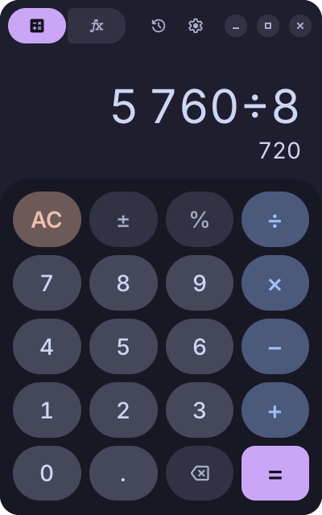
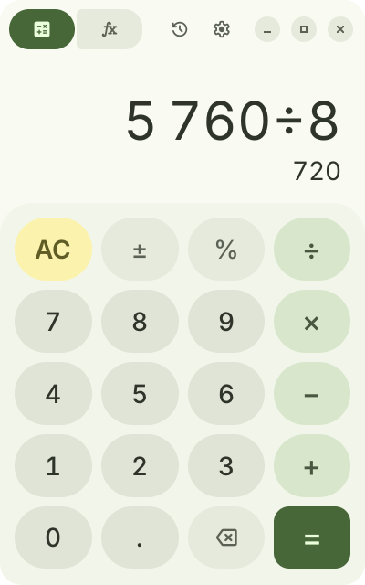

<p align="center">
  
</p>

<h1 align="center">Calculator</h1>

<p align="center">
  A GTK 4 calculator for Linux with a Material 3 Expressive style. It takes its colours from the desktop (dark mode and accent colour) or from a palette you choose.
</p>

<p align="center">
  
  
  
  
  
  
</p>

<p align="center">
  <a href="#installation">Install</a> ·
  <a href="#features">Features</a> ·
  <a href="#keyboard-shortcuts">Shortcuts</a> ·
  <a href="#colours">Colours</a> ·
  <a href="CHANGELOG.md">Changelog</a>
</p>

---

> **AI disclosure:** This project was written almost entirely by an AI assistant, with direction and testing by the author. It works on the setups it was tested on (Hyprland), but review the code before relying on it.

<p align="center">
   
</p>

<p align="center">
   
</p>

## Features

- Standard and scientific modes. Scientific adds trigonometric functions (degrees or radians), logarithms, powers, roots, factorial, absolute value, modulo, π, e, `Ans` and E notation.
- Live result preview while typing; pressing `=` again repeats the last operation.
- History of past results, saved between sessions (can be turned off).
- Colours from the desktop through the XDG Desktop Portal, GSettings or the GTK theme, so it works on GNOME, KDE, Hyprland, niri, Sway and others.
- Built-in palettes (Material seed colours plus Catppuccin, Nord, Gruvbox, Tokyo Night, Rosé Pine and Dracula), a custom accent colour, or a hand-written `palette.toml`.
- The launcher icon is recoloured to match the current palette.
- Full keyboard input.
- Point or comma as the decimal symbol (Preferences → Display). It is used for display, copy and paste; both `.` and `,` keys type it.
- The window keeps the size you give it and the mode you were in between sessions, and its position on Hyprland, Sway, niri (floating) and any X11 desktop. GNOME and KDE Plasma on Wayland place windows themselves. It opens small by default (220×330). Switching modes keeps the height and widens or narrows the window to match. Made smaller than its normal size, the window scales its keys and text down to fit, to about half size.

## Requirements

- GTK 4.10 or newer
- To build it: Rust 1.88 or newer and the GTK 4 development files

| Distribution | Command |
| --- | --- |
| Arch, CachyOS, Manjaro | `sudo pacman -S rust gtk4` |
| Debian, Ubuntu | `sudo apt install cargo libgtk-4-dev` |
| Fedora | `sudo dnf install cargo gtk4-devel` |

Without Rust, use the release download: it includes a ready-built program for x86-64 Linux.

## Installation

```sh
git clone https://github.com/HypestHyper/Calculator.git
cd Calculator
./install.sh                  # installs to ~/.local
```

The installer builds the program with cargo, then installs it with its icons, font and launcher entry. To update, run `git pull` and `./install.sh` again in the same folder. Settings and history are kept.

Without Rust, download `calculator-<version>.tar.gz` from the [latest release](https://github.com/HypestHyper/Calculator/releases/latest), unpack it and run `./install.sh` in its folder: it uses the ready-built program inside.

Use `sudo ./install.sh --system` to install to `/usr/local` (build first as yourself with `cargo build --release`), or `--prefix DIR` for another location. To remove it, run `./uninstall.sh` with the same option; add `--purge` to also delete settings and history.

On Arch-based systems you can build a package from `packaging/arch/PKGBUILD` instead.

To run from the source folder without installing: `cargo run --release`.

## Floating windows on tiling compositors

Wayland applications cannot request to float, so tiling compositors need a window rule. Preferences → Window shows the rule for your compositor with a copy button. You can also print it:

```sh
io.github.HypestHyper.Calculator --print-window-rules hyprland
io.github.HypestHyper.Calculator --print-window-rules niri
io.github.HypestHyper.Calculator --print-window-rules sway
```

Hyprland (Lua config, `~/.config/hypr/hyprland.lua`):

```lua
hl.window_rule({
    name = "calculator-float",
    match = { class = "^io\\.github\\.HypestHyper\\.Calculator$" },
    float = true,
})
```

niri (`~/.config/niri/config.kdl`):

```kdl
window-rule {
    match app-id=r#"^io\.github\.HypestHyper\.Calculator$"#
    open-floating true
}
```

Sway (`~/.config/sway/config`):

```
for_window [app_id="^io\.github\.HypestHyper\.Calculator$"] floating enable
```

For other compositors, match the app ID `io.github.HypestHyper.Calculator`.

The window resizes when switching modes. Hyprland ignores resize requests from floating windows, so on Hyprland the app resizes itself through `hyprctl`, in small steps so the window and its contents shrink together. On any other compositor that keeps the old size, the window is briefly reopened at the new size.

## Colours

Preferences → Colours → Colour source selects where colours come from: the desktop accent (default), a built-in preset, a custom colour, or a palette file.

Dark or light mode is taken from the first of these that gives an answer:

1. The Theme option in Preferences, or `mode` in the palette file
2. XDG Desktop Portal (`org.freedesktop.appearance`)
3. GSettings (`org.gnome.desktop.interface`)
4. GTK settings and the active GTK theme
5. Light, as a default

A full Material 3 palette (2025 specification) is generated from the accent colour. Changes on the desktop are applied while the app is running.

### palette.toml

With the colour source set to *Palette file*, the app reads `~/.config/io.github.HypestHyper.Calculator/palette.toml` and reloads it when saved. Preferences can create one from the current colours.

```toml
seed = "#2e7d32"        # generate the palette from this colour
style = "tonal_spot"    # tonal_spot, vibrant, expressive, fidelity, content,
                        # neutral, monochrome, rainbow, fruit_salad
# mode = "dark"         # force light or dark

[roles]                 # both modes
primary = "#ff6600"

[dark]                  # dark mode only
surface = "#000000"

[light]                 # light mode only
```

Roles use Material 3 names such as `primary`, `on_primary`, `primary_container`, `secondary_container`, `surface`, `surface_container_high` and `outline`. Camel case (`onPrimary`) and kebab case (`on-primary`) are also accepted.

## Keyboard shortcuts

| Keys | Action |
| --- | --- |
| `0`–`9`, `.`, `+ - * /`, `^`, `%`, `!`, `( )` | Input |
| `Enter`, `=` | Calculate |
| `Backspace` | Delete last |
| `Esc`, `Delete` | Clear, or close history |
| `Ctrl+C`, `Ctrl+V` | Copy result, paste |
| `Ctrl+H` | History |
| `Ctrl+S` | Scientific mode |
| `Ctrl+,` | Preferences |
| `s c t l g r p e`, `E` | sin, cos, tan, ln, log, √, π, e, E notation (scientific mode) |

## Files

| Contents | Location |
| --- | --- |
| Settings | `~/.config/io.github.HypestHyper.Calculator/settings.toml` |
| Palette | `~/.config/io.github.HypestHyper.Calculator/palette.toml` |
| Window size and history | `~/.local/state/io.github.HypestHyper.Calculator/` |

## Development

```sh
cargo run --release                    # run from the source folder
cargo test                             # run the tests
cargo clippy --all-targets
CALCULATOR_DEBUG=1 cargo run --release # print theme and window-size details
```

Development builds (`cargo run` without `--release`) start as a separate app even when Calculator is already open, so they can run next to it.

The app has switches for screenshots and timing:

- `CALCULATOR_SCREENSHOT=out.png CALCULATOR_KEYS="digit:7 op:× digit:6 eq:"` runs the steps, saves the window as a PNG and quits. Steps are key actions or `ui:mode`, `ui:inv`, `ui:angle`, `ui:history`, `ui:prefs` (the screenshot is then of Preferences), `ui:scroll:N` (scroll Preferences), `ui:set:key=value` (change a setting), `ui:size:WxH` (resize the window) and `ui:wait` (one second).
- `CALCULATOR_QUIT_ON_FIRST_FRAME=1` quits as soon as the window is drawn, to time start-up.
- `CALCULATOR_TIMING=1` prints how long each step of start-up took.
- The app uses GTK's GL renderer, which starts faster than the Vulkan one newer GTK versions default to. Set `GSK_RENDERER` (for example `vulkan` or `cairo`) to choose another.

| File | Purpose |
| --- | --- |
| `src/engine.rs` | Expression parser and number formatting |
| `src/logic.rs` | Key handling |
| `src/colors.rs` | Palette generation, presets, palette.toml |
| `src/scale.rs`, `src/scale_box.rs` | Scaling down in small windows |
| `src/main.rs` | Start-up, command-line options, development switches |
| `src/window.rs`, `src/preferences.rs` | User interface |
| `src/theme.rs` | Desktop colours (portal, GSettings, GTK) and CSS |
| `src/motion.rs` | Spring animations, key shapes and press feedback |
| `src/icons.rs` | Material Symbols icons |
| `src/config.rs` | Settings, window sizes and history files |
| `src/compositor.rs` | Hyprland window resizing |
| `src/placement.rs` | Saving and restoring the window position |
| `src/window_rules.rs` | Floating-window rules |
| `src/app_icon.rs` | Palette-coloured app icon |
| `src/style.css` | Styles; colours are filled in at runtime |
| `vendor/material-colors` | Material colour library (MIT or Apache 2.0), trimmed and patched; see its README |

## License

MIT, see [LICENSE](LICENSE). Third-party assets are listed in [THIRD_PARTY.md](THIRD_PARTY.md).
